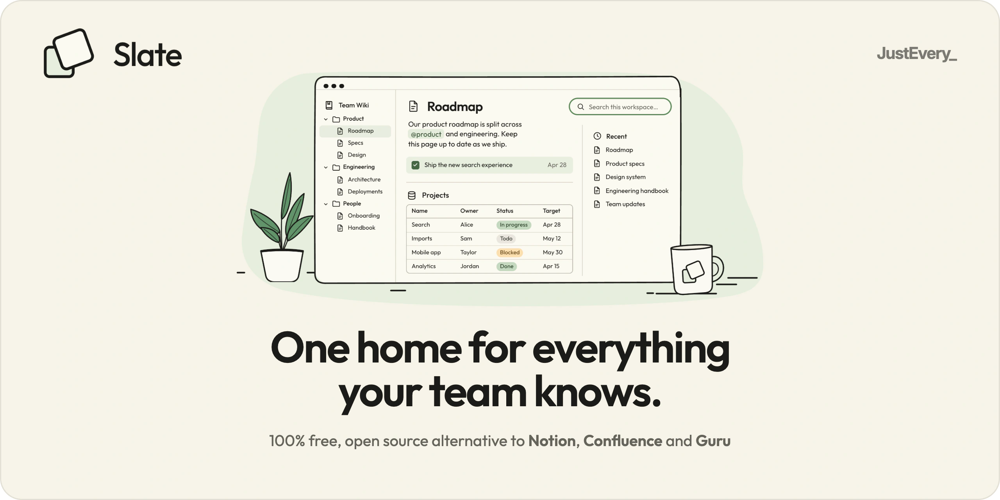
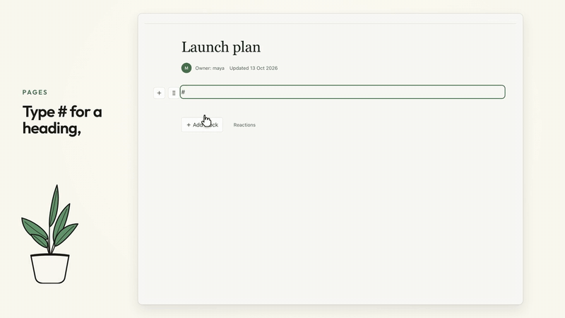
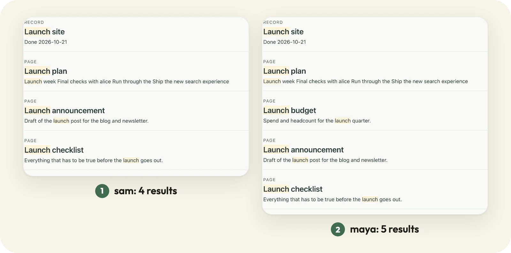
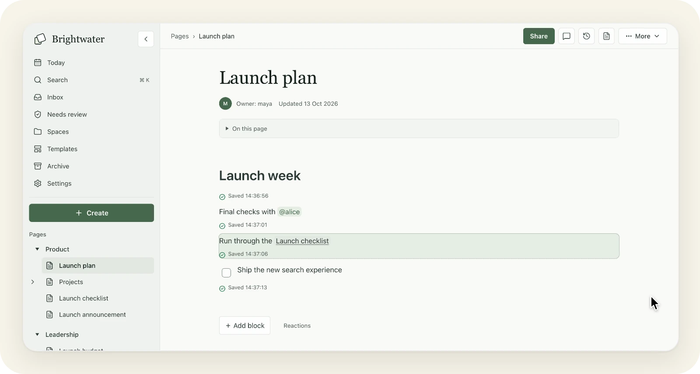
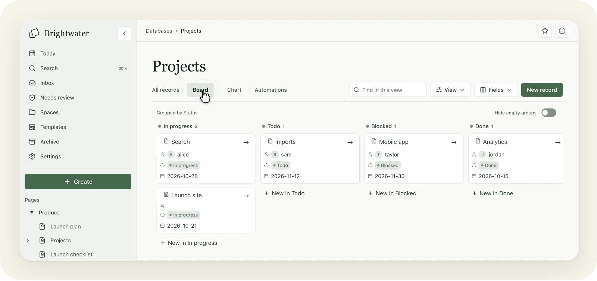

<p align="center">
  <a href="https://run-slate.com">
    <picture>
      <source media="(prefers-color-scheme: dark)" srcset=".github/assets/banner-dark.webp">
      <source media="(prefers-color-scheme: light)" srcset=".github/assets/banner-light.webp">
      
    </picture>
  </a>
</p>

<p align="center"><a href="https://run-slate.com">run-slate.com</a> · <a href="https://justevery.com">Part of Just Every</a> · <a href="LICENSE">MIT licensed</a></p>

<p align="center">
  <a href="https://justevery.com/#vol-slate"></a>
</p>
<p align="center"><a href="https://justevery.com/#vol-slate"><b>Watch the full demo</b></a> · 50 seconds</p>

<p align="center">
  
</p>

<p align="center">
  <br>
  <sub>Pages with mentions, page links and blocks that save as you write.</sub>
</p>

<p align="center">
  <br>
  <sub>Databases with board, chart and automation views.</sub>
</p>

# Slate

Slate is a self-hosted team wiki built with React, TanStack Start, Hono and Cloudflare Workers. The default `core-wiki` profile provides pages and containers, rich-text editing, comments, permissions, search, revision history, imports, and backup and restore. The public source repository is [just-every/run-slate](https://github.com/just-every/run-slate). Source publication does not establish product or provider acceptance.

Install Git and Node.js 22 or later to run rer. There is no Node or pnpm version to choose: the checkout pins Node.js **22.20.0** and pnpm **10.12.4**, and rer fetches and uses exactly those for its commands.

## Run it on your computer

Clone the public source repository and enter the checkout:

```sh
git clone https://github.com/just-every/run-slate.git slate
cd slate
```

Install rer once per computer (`npm install -g @runeditrun/rer`, or `curl -fsSL https://runeditrun.com/install.sh | sh`); it runs the `@runeditrun/rer` version this checkout pins (0.2.4). In a fresh checkout `rer dev` alone installs the pinned dependencies, makes a placeholder local owner and starts Slate. To choose your own owner email, prepare it first:

```sh
rer install
rer setup --owner-email you@example.test
rer dev
```

Use your own email address. Setup builds the real Worker, applies local migrations, writes mode-0600 `.dev.vars`, and requests an ordinary native sign-in message. It exits with no app running. A second setup preserves the saved settings bytes, workspace and owner. Slate declares `APP_URL` and `SETUP_OWNER_EMAIL`; it has no owner-name field. Conflicting saved choices require explicit recovery or reset.

Dev prints `RER_READY` and `RER_SIGN_IN` only after health and native outbox checks. Open the outbox, choose the newest **Read message**, then **Open this link** and **Confirm**. No email is sent. Each native sign-in link works once. An unfinished native owner lands at `/setup` to name the workspace and create its first space and page; completed setup proceeds to the app. Retained local data lives in `.wrangler/state`; credentials stay out of production builds.

In a second terminal, inspect the outbox and run the checks after stopping dev:

```sh
rer outbox
rer dev --stop
rer verify
```

`rer build` then `rer preview` serves a fixed production build. Dev supports Vite editing/HMR. Both reuse a compatible running instance, preserve the saved origin and native identity, and accept explicit loopback `--host`, `--port`, and `--idle-timeout`. Stop the active mode before changing modes. `rer doctor` reports missing local inputs without provider requests. `rer check --profile first-party` validates the command contract before dependencies or setup exist.

## Back up, restore and reset

Stop dev or preview before moving local data. Export to a new private file:

```sh
rer export --output exports/installation.rer
```

The archive includes D1 facts and identity lineage plus retained FILES attachments and source import originals. Derived ZIP exports, deleted files and unreferenced staging objects are excluded. Session capabilities, provider credentials, local configuration and transient caches are excluded. Native agent credential metadata is retained as revoked records with erased digests and empty scopes; no agent token or usable digest moves. Restore into a fresh empty checkout **before its first setup/sign-in**:

```sh
rer import --input exports/installation.rer --yes
rer setup --owner-email you@example.test
```

Re-enter the archived native owner's email. Fresh sign-in is required; restored automation, grants and effects require renewed owner authority. Existing workspace ZIP exports and the authenticated web restore API remain a separate native product flow. Hosted installation export uses `rer export --target remote --origin https://wiki.example.com --session-file .seed/owner-session --output exports/hosted.rer`; put only your native owner cookie in an owned mode-0600 session file. Remote installation import is unsupported; restore the archive into a separate empty local checkout first.

Reset lists its local removal inventory and requires explicit confirmation:

```sh
rer reset --yes
```

It removes local D1/R2/collaboration state, settings, outbox and installer drafts, preserving source, dependencies, owner exports and deployment receipts. Back up first. Reset refuses while another operation owns local state.

## Deploy to your Cloudflare account

Rer's own deploy kit deploys from the binding declaration in `deploy.json`; nothing is vendored in this repository. Supply `CLOUDFLARE_ACCOUNT_ID`, `CLOUDFLARE_API_TOKEN` and the declared `SLATE_*` inputs from your private vault: your owner email, an explicitly selected Resend or SendGrid provider, a verified sender and its API key (rer generates the session secret on a first deploy). Review the locally built declaration first:

```sh
rer deploy --environment production --dry-run
rer deploy --environment production
```

Dry run makes no provider request. The second command creates owner-account resources, applies migrations, uploads secrets, deploys and checks health. It requires separate deployment authorization. Slate has no setup token to claim or retire: you become the owner when you first sign in by email at the printed address as `SLATE_SETUP_OWNER_EMAIL`, then name the workspace at `/setup`. See [OPERATIONS.md](OPERATIONS.md) for inputs and limitations.

To update a deployed wiki, export it first (see [docs/INSTALL.md](docs/INSTALL.md#update-your-existing-wiki)), then:

```sh
git pull --ff-only
rer deploy --environment production
```

To remove a deployment and every resource rer created for it, including its data (export first):

```sh
rer deploy --environment production --remove --yes
``` Source `rer release --repo PATH --output PATH --clean-history` validates and prepares a local export; it does not push, tag a public repository or deploy.

## Verify and acceptance

```sh
rer verify
pnpm test:imports
pnpm test:release-source
pnpm source:check
```

`verify` checks generated Worker binding freshness, types and the emitted build, then runs the installer, local journey and outbox checks along with the foundation, platform, profile, type-generation, portability and operations checks. Planned contract clauses remain visible; a passing check does not imply full flagship acceptance. `pnpm test:release-regressions` separately exercises publication relocation, erasure and the emitted browser console; install Chromium with `pnpm exec playwright install chromium` first.

Advanced federation and inquiry code remains in the source under the explicit `SLATE_PROFILE=flagship` development profile. It is outside the core-wiki release acceptance. [CONTRACT.md](CONTRACT.md), [ACCEPTANCE.md](ACCEPTANCE.md), and [HANDOVER.md](HANDOVER.md) state requirements and current evidence limits. Slate is MIT licensed.
